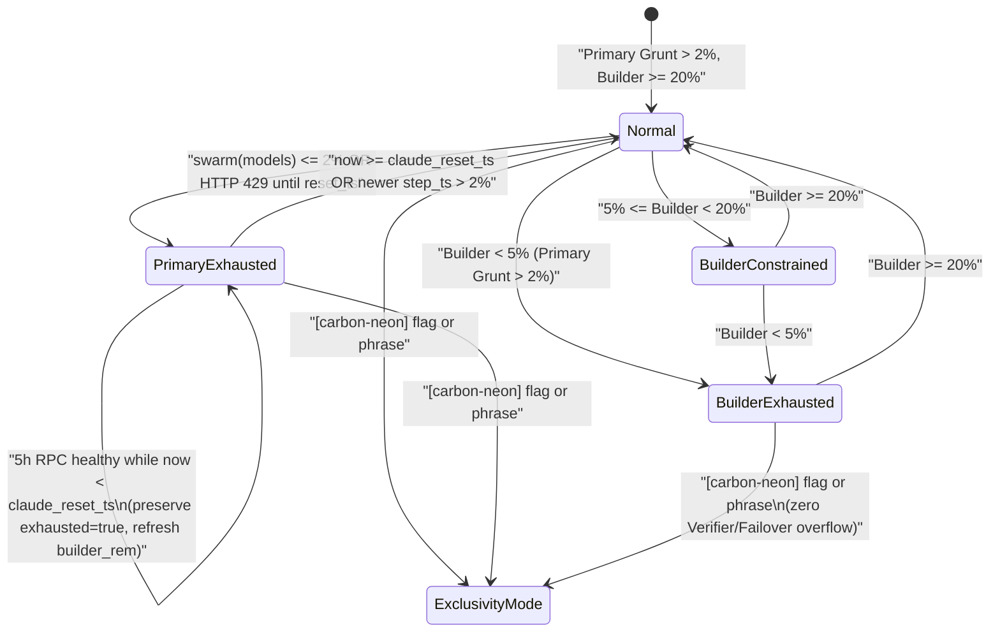

<p align="left">
  <a href="#readme"></a>
</p>

**Zero-dependency, deterministic `PreToolUse`/`PostToolUse` subagent router, dual-window quota state machine, and parent-context edit-budget guard for Claude Code and Google Antigravity (0 LLM tokens on the routing hot path).**

<p align="left">
  <a href="https://github.com/lusignan/model-router/actions/workflows/ci.yml"></a>
  <a href="#30-second-quickstart"></a>
  <a href="pyproject.toml"></a>
  <a href="pyproject.toml"></a>
  <a href="LICENSE"></a>
</p>

Built and battle-tested in production as a native **Google Antigravity** plugin (`swarm` routing + 5h RPC/weekly transcript quota reconciliation), with a built-in `PreToolUse`/`PostToolUse` wire adapter for **Claude Code** (`Task`/`Agent` `updatedInput` routing, parent edit-budget guard, HTTP 429 capture) and a pure-Python API (`model_router.decide`) for custom harnesses.

---

## What Happens on the Wire (Deterministic, `0` LLM Tokens)

Every hook call reads one JSON event from `stdin` and emits one deterministic JSON decision on `stdout` using pure Python stdlib—zero network round-trips, zero LLM calls on the routing path.

### 1. Deterministic Subagent Model Routing

When a root orchestrator spawns an `opus` subagent just to stage files and create a git commit, `model-router` intercepts the `PreToolUse` `Task` event and rewrites `model` to the fast tier while preserving every original `tool_input` field:

**`stdin` (Claude Code `PreToolUse`):**
```json
{
  "hook_event_name": "PreToolUse",
  "tool_name": "Task",
  "tool_input": {
    "description": "commit-crew",
    "prompt": "Stage tracked changes and create an atomic git commit.",
    "model": "opus",
    "subagent_type": "general-purpose"
  }
}
```

**`stdout` (`claude-code` preset):**
```json
{
  "hookSpecificOutput": {
    "hookEventName": "PreToolUse",
    "permissionDecision": "allow",
    "permissionDecisionReason": "Model Router [grunt.heuristic]: Untagged plumbing/mechanical worker routed to haiku (primary grunt tier).",
    "updatedInput": {
      "description": "commit-crew",
      "prompt": "Stage tracked changes and create an atomic git commit.",
      "model": "haiku",
      "subagent_type": "general-purpose"
    }
  }
}
```

> **Google Antigravity wire delta:** For the equivalent `swarm(action="add", ...)` hook payload under the default `antigravity` preset, `stdout` emits `{"decision": "allow", "overwrite": {"model": "claude-sonnet-5-5-low"}}`.

### 2. Blocking Oversized Inline Parent Edits

Once a heavy (`>= 1 MB`) Architect parent transcript exhausts its single surgical batch (`<= 4` files), the next inline `Edit` is denied so multi-file implementation moves to an isolated `Builder` subagent instead of polluting parent context:

**`stdin` (Claude Code `PreToolUse` after 4 edits in the active turn):**
```json
{
  "hook_event_name": "PreToolUse",
  "session_id": "sess-9a3f",
  "model": "opus",
  "transcript_path": "/path/to/transcript.jsonl",
  "tool_name": "Edit",
  "tool_input": {"file_path": "src/solver_kernel.py"}
}
```

**`stdout` (`claude-code` preset):**
```json
{
  "hookSpecificOutput": {
    "hookEventName": "PreToolUse",
    "permissionDecision": "deny",
    "permissionDecisionReason": "Model Router (Alloy policy): inline Architect edit limit (heavy >=1 MB thread (1100 KB; 1 parallel surgical batch / 4 files max)) reached. Architect owns specs, briefs, research, and adversarial review — never multi-turn edit-test loops. Write the exact spec and dispatch code building to Builder (\"sonnet\") and grunt work (docs/exports/guards/commits) to Grunt (\"[grunt]\")."
  }
}
```

---

## 30-Second Quickstart

### 1. Install (`pip` or `uv`, zero runtime dependencies)

```bash
git clone https://github.com/lusignan/model-router.git && cd model-router
pip install -e .   # or: uv tool install .
```

### 2. Verify in One Line from Your Shell (No Harness Required)

Pipe raw Claude Code hook JSON directly into `stdin` (uses the default `antigravity` preset unless `.agents/model-router.json` or `MODEL_ROUTER_CONFIG_PATH` selects `"preset": "claude-code"`):

```bash
printf '{"hook_event_name":"PreToolUse","tool_name":"Task","tool_input":{"description":"commit-crew","prompt":"Stage tracked changes and git commit.","model":"claude-opus-5-5-high"}}\n' \
  | PYTHONPATH=src python3 -m model_router
```

Or inspect a routing decision and exact Claude Code wire output with `--explain --pretty` (replace `model-router` with `PYTHONPATH=src python3 -m model_router` if running without `pip install -e .`):

```bash
model-router --explain --pretty \
  --preset claude-code \
  --harness claude-code \
  --name "commit-crew" \
  --model "opus" \
  --brief "Stage tracked changes and git commit."
```

### 3. Wire into Claude Code (`.claude/settings.json` + `.agents/model-router.json`)

Register the hook command in `.claude/settings.json` (complete template in [`examples/claude-code-settings.example.json`](examples/claude-code-settings.example.json)):

```json
{
  "hooks": {
    "PreToolUse": [
      {
        "matcher": "Task|Agent|Edit|MultiEdit|Write|NotebookEdit",
        "hooks": [
          {
            "type": "command",
            "command": "python3 /path/to/model-router/hooks/model_stack_router.py",
            "timeout": 10
          }
        ]
      }
    ],
    "PostToolUse": [
      {
        "matcher": "Task|Agent",
        "hooks": [
          {
            "type": "command",
            "command": "python3 /path/to/model-router/hooks/model_stack_router.py",
            "timeout": 10
          }
        ]
      }
    ]
  }
}
```

Then select the `claude-code` preset in your repository root's `.agents/model-router.json`:

```json
{
  "preset": "claude-code"
}
```

### 4. Wire into Google Antigravity (`~/.gemini/config/plugins/model-router`)

```bash
git clone https://github.com/lusignan/model-router.git \
  ~/.gemini/config/plugins/model-router
```

Antigravity discovers `plugin.json`, root `hooks.json`, `rules/AGENTS.md`, and `skills/` with zero external dependencies. Note: `PreToolUse`/`PostToolUse` hook execution requires an Antigravity surface and version with plugin lifecycle hooks enabled.

---

## Why a "Model Alloy"?

HTTP/proxy LLM routers (`LiteLLM`, `RouteLLM`, etc.) and `model-router` operate at **different, composable layers of the stack**: HTTP/proxy routers sit at the per-prompt API layer—routing individual model calls for cost, latency, or prompt difficulty, often via lightweight classifiers rather than LLM judges—whereas `model-router` operates inside the agent harness at `PreToolUse`/`PostToolUse` boundaries, governing subagent lifecycle roles, rolling/weekly quota windows, and root-session edit budgets (`0` LLM tokens). Most coding harnesses also default to single-model monocultures where one model plans, edits, tests, and approves its own diff, amplifying self-preference bias and local-optimum edit loops. Borrowing from metallurgy—where alloying combines distinct base metals so complementary properties offset individual failure modes—`model-router`'s policy engine ([`src/model_router/alloy.py`](src/model_router/alloy.py)) binds distinct model profiles to asymmetric lifecycle roles. **Multi-provider presets** (`antigravity`, `multi-provider`, and custom cross-vendor configs) route architecture/adversarial review, core implementation, and fast verification across **different model families** so no single model grades its own work and **blind spots are less correlated**; the **single-provider `claude-code` preset** tiers roles cleanly across `opus`, `sonnet`, and `haiku` within Anthropic's family (mapping both `architect` and `forensic` to `opus` unless paired with an external reviewer in `.agents/model-router.json`). Every dispatch resolves against semantic **role slots** (`ModelPool`) rather than hard-coded vendor strings, switchable via `"preset"` in `.agents/model-router.json` or `--preset` on the CLI:

| Role Slot (`models.*`) | Systems Role | `claude-code` | `antigravity` *(default)* | `multi-provider` |
|---|---|---|---|---|
| `architect` (`carbon`) | **Architect & Gatekeeper** — specs, causal/math derivations, dyad lead, final diff audit | `opus` | `gemini-4-carbon-high` | `o3` |
| `builder_xhigh` (`neon_xhigh`) | **Builder / 1M Empirical Partner** — core implementation, numerical kernels, full-repo X-ray & ablations | `sonnet` | `gemini-4-neon-xhigh` | `gemini-2.5-pro` |
| `builder_high` (`neon_high`) | **Builder / 1M Empirical Partner** *(step-down tier)* — light module builds under tight quota | `sonnet` | `gemini-4-neon-high` | `gemini-2.5-pro` |
| `grunt_high` (`sonnet_high`) | **Fast Verifier / Grunt** — docs/ledger sync, HTML/CSV exports, `compileall`/test/guard sweeps | `sonnet` | `claude-sonnet-5-5-high` | `claude-sonnet-4-5` |
| `grunt_low` (`sonnet_low`) | **Fast Verifier / Grunt** *(light tier)* — linting, formatting, monitoring, atomic commits | `haiku` | `claude-sonnet-5-5-low` | `claude-haiku-4-5` |
| `failover_grunt_high` (`hydrogen_high`) | **Failover Verifier / Grunt** — automatic failover when primary verifier/grunt quota `<= 2%` | `haiku` | `gemini-4-hydrogen-high` | `gemini-2.5-flash` |
| `failover_grunt_low` (`hydrogen_low`) | **Failover Verifier / Grunt** *(light tier)* — automatic failover for light plumbing/commits | `haiku` | `gemini-4-hydrogen-low` | `gemini-2.5-flash` |
| `forensic` (`opus`) | **Forensic Specialist** — strictly gated unspec'd root-cause debugging (`[opus]` or `< 1,800` chars) | `opus` | `claude-opus-5-5-high` | `claude-opus-4-6` |

---

## Control-Plane Deep Dive

Each control-plane component addresses a concrete production failure mode observed in long-running multi-agent coding sessions.

### 1. 8-Stage Deterministic Precedence Cascade (`alloy.py` & `text.py`)

Naive keyword or regex classifiers fail constantly on real engineering prompts because briefs quote file names, role tags, and negative constraints. `explain_swarm_route()` evaluates an 8-stage top-down cascade (`[carbon-neon]` exclusivity -> explicit `[grunt]` header -> superseded model -> untagged verifier/grunt heuristic -> Architect authorization vs. coding-loop redirect -> Builder / dyad upgrades -> quota exhaustion failover -> explicit specialist / default classification) on pre-cleaned text:

- **Code-span isolation (`mask_code_spans` / `strip_code_spans`):**
  Given worker `test-runner` with brief ``Do NOT redesign the architecture; just run pytest on `kalman_spec.py` ``, naive matching triggers on `"architecture"`, `"kalman"`, and `"spec"`, misrouting a test sweep to an Architect or `1M` Builder. `text.py` blanks backticked `` `kalman_spec.py` `` (and fenced code blocks) while preserving byte offsets, so `"run pytest"` routes cleanly via `grunt.heuristic` (`sonnet` on `claude-code` / `claude-sonnet-5-5-high` on `antigravity`) in `< 0.03 ms` warm in-process `model_router.decide()` at `0` LLM tokens.
- **Negation-safe scrubbing (`scrub_negated_coding_markers`):**
  Given worker `arch-review` with brief ``@arch-review [carbon] Audit patch 2 in `kalman_filter.py`; do NOT call edit_file``, naive substring rules trip `"patch "` and `"edit_file"` as a coding loop and wrongly demote the Architect to a Builder. `scrub_negated_coding_markers()` strips negated tool prohibitions (`do NOT call edit_file`) and audit/review noun phrases (`Audit patch`) before checking coding-loop markers, keeping the Architect on review (`carbon.explicit_authorized`) while still redirecting positive directives like `"Apply patch 2 and call edit_file"` (`carbon.coding_loop_redirect`).

### 2. Parent-Context Inline Edit-Budget Guard (`guards.py`)

Running a $K$-turn inline edit-test-fix loop inside a mature parent session (context $C_0 \approx 250{,}000$ tokens on a `1 MB` transcript, growing by $\Delta C$ per turn) triggers premature context compaction that degrades architectural reasoning and rebills the entire parent history on every turn. Capping heavy (`>= 1 MB`) Architect transcripts to `1` parallel surgical batch (`<= 4` files; lean `< 1 MB` threads allow `<= 2` batches / `<= 5` files) forces multi-file implementation into an isolated `Builder` worker starting from a compact spec ($C_{\text{spec}} \ll C_0$), leaving the Architect to spend only $2$ turns (spec + final diff audit $\Delta C_{\text{diff}}$):

$$T_{\text{monolith}}(K) = K C_0 + \frac{K(K-1)}{2}\Delta C \quad \text{vs.} \quad T_{\text{Architect}}^{\text{routed}} \approx 2 C_0 + \Delta C_{\text{diff}}$$

| Sequential Build Turns ($K$) | Parent Context ($C_0$) | Per-Turn Growth ($\Delta C$) | Monolithic Architect Input Tokens | Routed Architect Input Tokens | Frontier Pool Reduction |
|---:|---:|---:|---:|---:|---:|
| `10` | `250k` | `8k` | `2.86M` | `~510k` | **`5.6x`** |
| `16` | `250k` | `8k` | `4.96M` | `~510k` | **`9.7x`** |
| `20` | `250k` | `10k` | `6.90M` | `~515k` | **`13.4x`** |

### 3. Dual-Window `resetTime`-Aware Quota Failover State Machine (`quota.py`)

Unattended multi-hour runs fail in two subtle ways: rolling `5h` RPC snapshots (`GetCascadeModelConfigData`) can still read healthy while a fixed `weekly` provider cap (`swarm(action="models")` in `transcript_full.jsonl` or HTTP `429` in `PostToolUse`) is exhausted, and `PostToolUse` hooks can fire 100–300 ms before the host flushes the `TOOL_RESULT` line to disk. `quota.py` reconciles both windows asymmetrically—separating cache TTL (`ts`) from transcript watermark (`step_ts`) to defeat the flush race—automatically fails over `Fast Verifier / Grunt` work when primary quota drops `<= 2%`, and recovers on exact `resetTime` boundaries:



### 4. Wire-Protocol Adapters & Layered `.agents/model-router.json` Config (`adapters.py` & `config.py`)

`adapters.py` auto-detects the active wire schema in constant time: Claude Code snake_case payloads (`tool_name`/`tool_input` -> `hookSpecificOutput.updatedInput` on rewrite, `{}` on passthrough) vs. Google Antigravity camelCase payloads (`toolCall` -> `{"decision":"allow","overwrite":{"model":"..."}}`).

Configuration merges deterministically in ascending priority without touching plugin code:
1. Built-in domain-agnostic defaults (`RouterConfig.default()`).
2. Global overrides: `$MODEL_ROUTER_CONFIG_PATH` / `$AGY_ROUTER_CONFIG_PATH` (if set), else `$PLUGIN_DATA/{alloy,model-router}.json` and `~/.gemini/config/{alloy,model-router}.json`.
3. Workspace overrides: ancestor `.agents/alloy.json` and `.agents/model-router.json` walking upward from `cwd` (or `workspacePaths[0]`) to `.git`.

Ready-to-copy templates live in [`examples/`](examples/):
- [`examples/claude-code-settings.example.json`](examples/claude-code-settings.example.json) — Drop-in Claude Code `.claude/settings.json` hook registration.
- [`examples/workspace-model-router.example.json`](examples/workspace-model-router.example.json) — Workspace keyword, role-slot, and threshold overrides.
- [`examples/multi-provider.example.json`](examples/multi-provider.example.json) — Cross-vendor `o3` / `gemini-2.5-pro` / `claude-sonnet-4-5` / `gemini-2.5-flash` preset.

---

## Companion Workflow Protocols (`skills/`)

The runbooks under `skills/` are **optional, composable workflow protocols layered on top of the deterministic hook router**. You can use `model-router` purely as a silent hook router, or pair it with these role-separated protocols:

```mermaid
flowchart LR
    H1["Claude Code Hook\ntool_name / updatedInput"] --> AD["Wire Adapter\nadapters.py"]
    H2["Antigravity Hook\ntoolCall / overwrite"] --> AD
    AD --> Q{"Spec Locked?"}
    Q -- "No (Research & Audit Dyad)" --> CD["Architect\nHypotheses & Falsifiable Predictions"]
    CD -- "Handoff" --> ND["Builder / 1M Empirical Partner\nFull-Repo X-Ray & OOS Ablations"]
    ND -- "Evidence" --> RT["Architect Red-Team\nLeakage & Subgroup Audit"]
    RT -- "Unresolved" --> ND
    RT -- "Verified" --> S1["1. Architect Spec\nLocked Math & File Contract"]
    Q -- "Yes (4-Stage Build Loop)" --> S1
    S1 --> S2["2. Builder Implementation\nIsolated Core Code Build"]
    S2 --> S3["3. Fast Verifier / Grunt\nTests, Docs & Commits (w/ Failover)"]
    S3 --> S4["4. Gatekeeper Audit\nIndependent Diff & Tail-Slice Check"]
    S4 --> D["Shipped Artifact / Commit"]
```



- **Research & Audit Dyad ([`skills/research-dyad/SKILL.md`](skills/research-dyad/SKILL.md)):** Pre-spec adversarial loop between a reasoning-heavy *Architect* and a long-context *1M Empirical Partner* to falsify hypotheses against full-repo call graphs and out-of-sample slices before code is written.
- **4-Stage Build & Verification Loop ([`skills/alloy-build/SKILL.md`](skills/alloy-build/SKILL.md)):** Role-separated `Spec -> Implement -> Deterministic Verify -> Adversarial Audit` pipeline: under multi-provider presets (`antigravity`, `multi-provider`), build and review span different model families so no model grades its own work and **blind spots are less correlated**, while the single-provider `claude-code` preset tiers `sonnet` implementation under `opus` review.

---

## Latency Benchmarks, Repository Layout & Development

### Measured Latency (`benchmarks/bench_router.py`)

Measured on **Python 3.14.3 (`Darwin arm64`)**. Microsecond/sub-millisecond figures (`0.018 ms` p50 on Claude Code `Task` -> `updatedInput`; `0.028 ms` aggregate warm p50, `1.473 ms` p95, `2.019 ms` p99 across `2,000` calls covering `7` Antigravity + Claude Code `PreToolUse`/`PostToolUse` workloads) apply to **warm in-process `model_router.decide()`** calls, whereas standalone `PreToolUse`/`PostToolUse` CLI hook invocations (`python3 ./hooks/model_stack_router.py`, `308.024 ms` p50, `382.833 ms` p95, `402.622 ms` p99 across `20` cold runs) are dominated by cold Python interpreter process startup rather than routing evaluation:

| Workload | Iterations | p50 (ms) | p95 (ms) | p99 (ms) | Throughput (ops/s) | LLM Tokens |
|---|---:|---:|---:|---:|---:|---:|
| PreToolUse: Antigravity dyad upgrade (`[neon-dyad]`) | 286 | 0.020 | 0.031 | 0.072 | 43,530 | 0 |
| PreToolUse: Antigravity grunt (`[grunt]` + code spans) | 286 | 0.028 | 0.031 | 0.055 | 34,189 | 0 |
| PreToolUse: Architect coding-loop redirect | 286 | 0.031 | 0.040 | 0.061 | 30,460 | 0 |
| PreToolUse: Claude Code `Task` -> `updatedInput` | 286 | 0.018 | 0.019 | 0.026 | 55,988 | 0 |
| PreToolUse: inline heavy (`>=1 MB`) edit guard | 286 | 0.471 | 0.788 | 1.968 | 1,815 | 0 |
| PreToolUse: `invoke_subagent` guard | 285 | 0.003 | 0.003 | 0.004 | 333,114 | 0 |
| PostToolUse: `256 KB` JSONL transcript quota poll | 285 | 1.357 | 2.279 | 5.879 | 650 | 0 |
| **Aggregate warm in-process (`decide()`)** | **2,000** | **0.028** | **1.473** | **2.019** | **3,194** | **0** |
| Cold hook subprocess (`python3 ./hooks/model_stack_router.py`) | 20 | 308.024 | 382.833 | 402.622 | 3 | 0 |

### Repository Layout

```text
model-router/
├── src/model_router/     # Pure-stdlib control plane (adapters, alloy, cli, config, guards, quota, text)
├── hooks/                # Executable PreToolUse/PostToolUse shim (model_stack_router.py)
├── skills/               # Optional workflow runbooks (research-dyad, alloy-build)
├── rules/                # Plugin operating rules (AGENTS.md)
├── examples/             # Drop-in Claude Code, workspace override, and multi-provider JSON templates
├── assets/               # SVG header, emblem, favicon & 1280x640 OpenGraph preview
├── benchmarks/           # Warm decide() & cold subprocess latency harness (bench_router.py)
├── tests/                # 48 stdlib unittest / pytest tests covering routing, quota, guards & hygiene
└── docs/                 # ARCHITECTURE.md (module topology, wire adapters & state machines)
```

### Development & Verification

```bash
pytest -q
python3 -m unittest discover -s tests -v
mypy --strict src
ruff check src tests benchmarks hooks
python3 benchmarks/bench_router.py --assert-p99-ms 10.0
```

See [`docs/ARCHITECTURE.md`](docs/ARCHITECTURE.md) for the complete module topology, cross-harness wire-adapter contract, 8-stage Model Alloy precedence cascade, negation-safe scrubbing rules, and `PostToolUse` JSONL disk-flush race sequence diagram.

---

## License

MIT — see [`LICENSE`](LICENSE).
