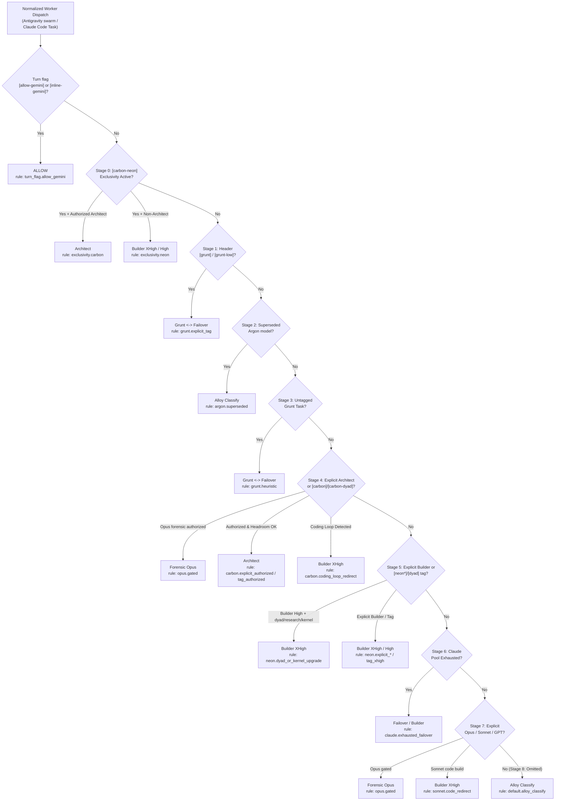
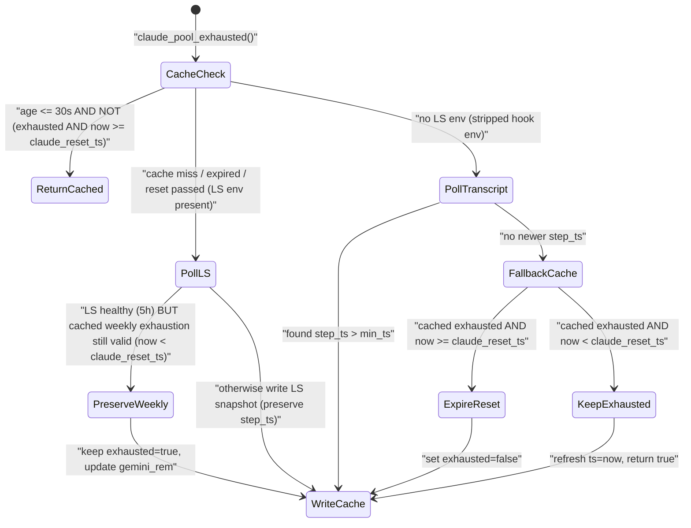
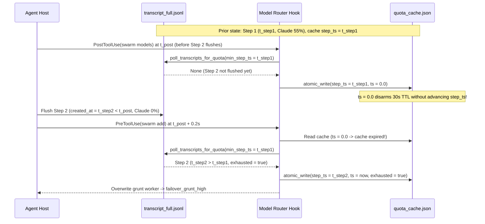

# Model Router Architecture

This document specifies the internal architecture of `model-router`: its cross-harness wire protocol adapter (**Google Antigravity** and **Claude Code**), its core **Model Alloy** (`model_router.alloy`) 8-stage routing policy, negation-safe text extraction, dual-window quota state machine, inline edit-budget guard, and cross-platform persistence contract.

---

## 1. Module Topology

`model-router` ships zero third-party runtime dependencies (pure Python 3.9+ stdlib, `mypy --strict` clean) and separates control-plane mechanics from routing policy across seven modules under `src/model_router/`:

| Module | Layer | Responsibility |
|---|---|---|
| `adapters.py` | Control Plane | Auto-detects wire schema (`antigravity` camelCase vs. `claude-code` snake_case), translates Claude Code `Task`/`Agent`/`*swarm*` rewrites into `hookSpecificOutput.updatedInput` preserving all original keys, gates Architect inline edits (`Edit`/`MultiEdit`/`Write`/`NotebookEdit`), and forwards `PostToolUse` `tool_response` 429 errors. |
| `config.py` | Control Plane | Immutable `RouterConfig` (`AlloyConfig` alias), `ModelPool` with semantic role-slot properties (`architect`, `builder_xhigh`, `builder_high`, `grunt_high`, `grunt_low`, `failover_grunt_high`, `failover_grunt_low`, `forensic`), named presets (`antigravity`, `claude-code`, `multi-provider`), layered JSON discovery (`.agents/model-router.json` & `.agents/alloy.json`), and cross-platform state paths. |
| `text.py` | Control Plane | Offset-preserving Markdown code-span masking (`mask_code_spans`, `strip_code_spans`), header-bounded worker tag extraction (`extract_worker_tags`), turn-flag isolation (`extract_turn_flags`), exclusivity detection, and negation/audit-noun scrubbing (`scrub_negated_coding_markers`). |
| `quota.py` | Control Plane | Dual-window `resetTime`-aware quota state machine: reverse-seek `transcript_full.jsonl` scanning, lazy `urllib.request` Language Server `GetCascadeModelConfigData` polling, asymmetric 5h-vs-weekly merge, `PostToolUse` flush-race invalidation, and `until <ISO>` 429 error circuit breaking. |
| `guards.py` | Control Plane | `PreToolUse` guards: unmanaged `invoke_subagent` blocker (exempting configured specialists), `run_workflow` `agent(...)` blocker, and lean/heavy inline Architect edit & planner-batch capper. |
| `alloy.py` | Policy Engine | **The Model Alloy component**: 8-stage cognitive-asymmetry & Research & Audit Dyad classifier returning structured `RouteExplanation` records with stable `rule_id`s. |
| `cli.py` / `__main__.py` | Control Plane | Harness-aware `decide()`, `--explain [--preset] [--harness] [--pretty]` diagnostic CLI, and `--refresh-quota`, failing open cleanly on malformed stdin (`{}` for Claude Code / `PostToolUse`, `{"decision":"allow"}` for Antigravity `PreToolUse`). |

The executable hook shim `hooks/model_stack_router.py` prepends `src/` to `sys.path`, re-exports the public API, and invokes `cli.main()`.

---

## 2. Multi-Harness Wire Adapter (`adapters.py`)

`detect_harness(payload, harness_override="auto")` inspects top-level keys in constant time:
- `"toolCall"` or `"hookEventName"` -> `"antigravity"`
- `"tool_name"` or `"hook_event_name"` or `"tool_input"` -> `"claude-code"`

| Capability | Antigravity Wire Contract | Claude Code Wire Contract |
|---|---|---|
| **Worker dispatch tool** | `toolCall.name` matching `*swarm*` (`args.name`, `args.brief`, `args.model`) | `tool_name` in `("Task", "Agent")` (`tool_input.description`, `tool_input.prompt`, `tool_input.model`) or `*swarm*` |
| **Model rewrite response** | `{"decision": "allow", "overwrite": {"model": "<target>"}}` | `{"hookSpecificOutput": {"hookEventName": "PreToolUse", "permissionDecision": "allow", "permissionDecisionReason": "...", "updatedInput": {...tool_input, "model": "<target>"}}}` |
| **Pass-through allow** | `{"decision": "allow"}` | `{}` |
| **Inline Architect edit cap** | `edit_file` / `write_file` / `replace_file_content` / `multi_replace_file_content` / `write_to_file` on Gemini parent | `Edit` / `MultiEdit` / `Write` / `NotebookEdit` when `payload.model` or `CLAUDE_MODEL` matches Architect tier (`opus`, `carbon`, `orchestrator`, `o3*`, or `cfg.models.architect`) |
| **PostToolUse 429 capture** | `payload.error` + `transcriptPath` | `payload.error`, `payload.tool_response.error`, or string `payload.tool_response` matching quota markers |

---

## 3. Deterministic 8-Stage Model Alloy Precedence (`alloy.py`)

Every worker dispatch passes through `explain_swarm_route()` in strict top-down precedence so explicit user intent and safety invariants can never be overridden by body prose:



> **Preset role separation:** **Multi-provider presets** (`antigravity`, `multi-provider`, and custom cross-vendor configs) route build and adversarial/forensic review across different model families so no model grades its own work and **blind spots are less correlated**. The **single-provider `claude-code` preset** tiers roles cleanly across `opus`, `sonnet`, and `haiku` within Anthropic's family (mapping both `architect` and `forensic` to `opus` unless paired with an external reviewer in `.agents/model-router.json`).

---

## 4. Code-Span Isolation & Negation-Safe Scrubbing (`text.py`)

Naive substring classifiers suffer from three chronic false positives on engineering briefs:

1. **Quoted tags inside docs/sync briefs:** A `[grunt]` worker updating docs that quote `` `[neon]` `` or fenced blocks containing `[carbon]` would be misclassified as Architect/Builder.
   - **Fix:** `mask_code_spans()` blanks inline (`` `...` ``) and fenced (` ```...``` `) spans while preserving byte and line offsets. `extract_worker_tags()` inspects strictly `worker_name` plus the first non-empty line and first `240` masked characters of `brief`, and never reads worker role tags from `lastUserInput`.
2. **Untagged plumbing workers referencing modeling nouns:** Workers such as `sync-status` summarizing `kalman` and `cholesky` results stay on Grunt, while `sync-engine` implementing `kalman` routes to `builder_xhigh`.
   - **Fix:** `is_plumbing_grunt()` balances `plumbing_name_tokens` against `core_code_build_keywords`.
3. **Negated prohibitions & audit noun phrases in Architect briefs:** Briefs stating `"Audit patch 2 in filter.py; do NOT call edit_file"` or `"Review the patches; never invoke edit_file or write_file"` previously tripped `carbon_code_loop_markers`.
   - **Fix:** `scrub_negated_coding_markers()` strips negated tool/patch prohibitions (including conjunctions) and audit/review noun phrases matching `patch(?:es)?\b` before checking coding-loop markers, while leaving positive directives (`"Apply patch 2 and call edit_file"`) intact.

---

## 5. Dual-Window Quota State Machine & `PostToolUse` Flush-Race Resolution (`quota.py`)

### State Transitions



### Resolving the `PostToolUse` JSONL Disk-Flush Race

In Antigravity, `PostToolUse` for `swarm(action="models")` can execute ~100–300 ms **before** the host flushes the newly completed `TOOL_RESULT` line (`created_at = t_step2 < t_post`) to `transcript_full.jsonl`. Separating **cache freshness (`ts`)** from **transcript watermark (`step_ts`)** prevents stale TTL locks:



When `PostToolUse` carries a quota/429 error (on Antigravity or Claude Code `tool_response`), `handle_post_tool_use()` checks the error **before** scanning transcripts—immediately persisting `source="post_tool_error"`, `error_ts=now`, and `claude_reset_ts` parsed from `until <ISO-8601>` so older healthy transcript snapshots (`step_ts < error_ts`) never mask an active 429 error.

---

## 6. Inline Edit Budget & Cross-Platform Persistence

### Architect Inline Edit Guard (`guards.py`)

- **Lean threads (`< 1 MB`):** up to `5` file edits across up to `2` `PLANNER_RESPONSE` batches per user turn.
- **Heavy threads (`>= 1 MB`):** `1` parallel surgical batch of up to `4` files; any 2nd planner batch is denied so multi-turn build loops move to an isolated Builder worker (`5–10x+` reduction in frontier rebilling).
- **Exemptions:** Artifact writes, `/.gemini/` or `/brain/` paths, non-Architect parent sessions, and spawned swarm workers (`<swarm_worker>` or `step_index == 0, SYSTEM_MESSAGE`).

### Cross-Platform State File Paths (`config.py`)

1. Explicit env override (`MODEL_ROUTER_QUOTA_CACHE_PATH` / `AGY_ROUTER_QUOTA_CACHE_PATH`, and `*_EDIT_STATE_PATH`).
2. Plugin persistent storage (`$PLUGIN_DATA/quota_cache.json` and `$PLUGIN_DATA/turn_edits.json`).
3. Per-user home cache (`~/.gemini/antigravity/cache/model_router/`, mode `0o700` on POSIX when writable).
4. Cross-platform fallback (`tempfile.gettempdir()` keyed by `os.getuid()` on POSIX or `getpass.getuser()` on Windows).

All state writes use sibling temporary files (`tempfile.mkstemp`) + `os.replace()`.

---

## 7. Measured Latency Profile (`benchmarks/bench_router.py`)

Measured on **Python 3.14.3 (`Darwin arm64`)**. Microsecond/sub-millisecond latencies (`0.018 ms` p50 `Task` rewrite; `0.028 ms` aggregate warm p50, `1.473 ms` p95, `2.019 ms` p99 across `2,000` calls) apply to **warm in-process `model_router.decide()`** calls, whereas standalone `PreToolUse`/`PostToolUse` CLI hook latency (`308.024 ms` p50, `382.833 ms` p95, `402.622 ms` p99) is dominated by cold Python process startup rather than routing evaluation:

| Workload | Iterations | p50 (ms) | p95 (ms) | p99 (ms) | Throughput (ops/s) | LLM Tokens |
|---|---:|---:|---:|---:|---:|---:|
| PreToolUse: Antigravity dyad upgrade (`[neon-dyad]`) | 286 | 0.020 | 0.031 | 0.072 | 43,530 | 0 |
| PreToolUse: Antigravity grunt (`[grunt]` + code spans) | 286 | 0.028 | 0.031 | 0.055 | 34,189 | 0 |
| PreToolUse: Architect coding-loop redirect | 286 | 0.031 | 0.040 | 0.061 | 30,460 | 0 |
| PreToolUse: Claude Code `Task` -> `updatedInput` | 286 | 0.018 | 0.019 | 0.026 | 55,988 | 0 |
| PreToolUse: inline heavy (`>=1 MB`) edit guard | 286 | 0.471 | 0.788 | 1.968 | 1,815 | 0 |
| PreToolUse: `invoke_subagent` guard | 285 | 0.003 | 0.003 | 0.004 | 333,114 | 0 |
| PostToolUse: `256 KB` JSONL transcript quota poll | 285 | 1.357 | 2.279 | 5.879 | 650 | 0 |
| **Aggregate warm in-process (`decide()`)** | **2,000** | **0.028** | **1.473** | **2.019** | **3,194** | **0** |
| Cold hook subprocess (`python3 ./hooks/model_stack_router.py`) | 20 | 308.024 | 382.833 | 402.622 | 3 | 0 |
